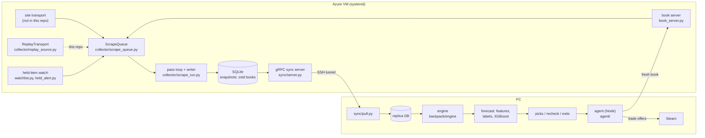

# Automatic-Trader-Tf2

An automated trader for Team Fortress 2 cosmetics. It recorded the backpack.tf order book
for about 3,000 items every hour for seven weeks, learned which buy orders were about to
rise, and ran a taker-only Steam bot on those predictions for a week of live trading.

- **Collector** (Python, ran on an Azure VM): one order book per item per hourly pass, stored
  zstd-compressed in SQLite, synced to a PC over gRPC.
- **Analysis engine** (Python, pandas + XGBoost): reads the books under fixed rules, builds
  138 point-in-time features, and scores `p_up`, the chance that the buy side rises past
  today's ask within 48 h.
- **Agent** (Node.js): takes the model's picks, re-checks each one on a fresh book, sends
  the Steam trade offers once the user approves them (or within `limits.json` in auto mode), and sells on a take-profit or
  horizon rule.

The project is finished: the agent is retired (`agent/limits.json` has `max_keys_in_play: 0`)
and the collector is stopped. This repository is a public copy with a fresh history. The
part of the collector that fetched pages from the website is not included (see
[What is not here](#what-is-not-here)).

## Architecture



The six stages in one line each:

1. **Requests and 2. collection.** One call per book (up to 30 listings a side, plus the
   side totals), Unique and Strange qualities, up to ~4,465 goods a pass (2,989 of them tradable). Stored
   unfiltered: a rule that could be wrong is never applied when the data is written.
3. **Storage.** `snapshots.book_json` is zstd with a dictionary trained on the books
   themselves: 7.4× smaller (18.7 KB to 1.4 KB a book). The VM's database is the only
   writer; the PC pulls a read-only replica over gRPC (`sync/`, append/changed/full mode
   per table).
4. **Inference** (`backpack/engine/book.py`). Every read applies the same rules: drop
   different goods (spelled, painted, parted, Strange), a median-ratio fence against
   outlier prices, and an untrusted-account list. The rules are versioned
   (`READ_KEY`), and the caches rebuild when the rules change.
5. **Model** (`backpack/engine/forecast/`). The label: does the buy-order median reach the
   ask +2% within 48 h. 138 features from the book, its history and the bots' behaviour
   (`bot_features.py`, `bot_groups.py`). XGBoost, tested with a purged walk-forward.
6. **Execution** (`agent/`). The rule is `p_up >= 0.65`, an ask of 0.1 to under 2 keys,
   best `p_up` first. Exit: sell at +4% before 48 h, otherwise into the best bid from 48 h,
   waiting up to 24 h. The agent only takes existing listings and only trades with
   instant-trade bot accounts. Limits are in `agent/limits.json`. There is a kill switch,
   and the account's secrets stay outside the repository.

## Results

Every number is measured on the full private data (2026-11-07). The three kinds of number
are labelled, because they mean different things:

| kind | what it measures | caveat |
|---|---|---|
| **backtest** | the model scored on days it was not trained on | no trades: ranks and calibration only |
| **replay** | the agent's rule run on stored books | **fills are assumed** |
| **live** | real Steam trades by the agent | small sample |

### Collection

| | |
|---|---|
| Books collected | **1,891,323** in 597 hourly passes, 2026-10-04 to 11-05 (plus 765,982 earlier ones on an older endpoint) |
| On the VM | 470 passes logged, 1,538,855 books, **0 failed**; 21 days without a reboot |
| Speed | median **1,306 books/min** from one IP (the endpoint's ceiling); ~765/min under a self-imposed 800 calls/min cap |
| A pass | ~4,465 goods in a median 343 s |
| Storage | **7.4×** compression with a trained zstd dictionary (472.7 to 63.9 MB on 8 passes) |
| Cost | about ₹93 (≈ $1.10) a day for the VM |

### The model

| kind | result |
|---|---|
| backtest | AUC **0.73-0.79 a day** over 8 out-of-sample days (10-16 to 10-24), 201,816 rows, base rate 11.3% |
| backtest | calibration: `p_up` 0.55 → 54% went up; 0.65 → 60%; 0.74 → 69%; 0.83 → 84% |
| backtest | the same 540 picks over the same 8 days: model **+1.2% a trade (+4.08 keys)**; every simple rule tried lost 0.5-0.9% a trade (logistic fits too, even in-sample); the model was ahead on 6-8 of the 8 days |
| replay | the agent's rule on stored books, 10-16 to 10-24: **61 trades, 92% won, +4.2% a trade** (fills assumed) |
| speed | 0.063 ms a book in a batch on 12 CPU threads; ~36 ms a book end to end, 99.6% of it building the features |

### Live trading

| | |
|---|---|
| Period | 2026-10-26 21:12 to 11-02 17:03 UTC (about 7 days) |
| Trades | **46 sold, 40 won (87%), +0.4244 keys** in total |
| Per trade | mean **+2.83%**, median +4.24%; median hold 17 h |
| Exits | 34 take-profit, 7 at the 48 h horizon, 5 by hand |
| Capital | 12.59 keys of entries; at most 2 keys in play |
| Fills | 46 of 52 buy offers accepted; 5 positions abandoned (no fill) |

46 trades over 7 days is a small sample. The trading rule was set from the replay, not
tuned on the live trades.

## How it was tested

- **Purged walk-forward.** Each test day is scored by a model trained only on rows whose
  48 h label had closed before that day starts. A position that waited past the horizon for
  a buyer stays out of training until it closes.
- **Against simple rules.** The model was compared with simple rules (spread, recent
  bid rise, logistic fits) on the same picks over the same days, not just against a
  random baseline.
- **Replay on stored books** (`python -m engine replay`). The agent's real decision code
  is run pass by pass on the books it would have seen. Fills are assumed.
- **Research that did not ship.** Stacked models, a GRU, ranking objectives, a bot-move
  model, seller-cost features and Steam Market history were each tested and rejected.
  The verdicts are in [docs/findings-index.md](docs/findings-index.md), and each study's
  write-up is in `research/*/README.md`.
- **Unit tests.** 19 engine test files, 7 collector test files and 94 agent tests. They
  run offline, on temporary SQLite databases and faked transports, and need no network.

```powershell
python -m venv .venv
.venv\Scripts\Activate.ps1
pip install -r requirements.txt
powershell -ExecutionPolicy Bypass -File backpack\run_tests.ps1
powershell -ExecutionPolicy Bypass -File collector\run_tests.ps1
cd agent; npm ci; node --test
```

## Try it on the sample

`sample/sample.db` is a real slice of the data: 50 goods over 7 days (164 passes, 8,073
books, 10 MB), anonymised. See [sample/README.md](sample/README.md).

```powershell
cd backpack
python -m engine forecast --db ../sample/sample.db                 # today's scores on the sample's last pass
python -m engine forecast --db ../sample/sample.db --backtest      # the walk-forward (too little data to mean much)
python -m engine history "Team Captain" --db ../sample/sample.db   # one item's book over time
cd ..
python collector/scrape_run.py --db replayed.db --passes 5 --book-port 0   # the collector's pass loop, fed from the sample
```

The sample shows the pipeline running. It is far too small to reproduce the results:
50 goods over 7 days give a few thousand labelled rows, against about 200,000 in the
real backtest. It also has no trade-offer URLs, so `engine replay` finds no tradable
seller and buys nothing.

## Repository layout

| path | what |
|---|---|
| `collector/` | the public half of the collector: `scrape_queue.py` (the queue and its transport interface), `scrape_run.py` (the pass loop), `replay_source.py` (stored books as input), `snapshot_store.py` (the schema), `book_codec.py` (zstd), `watchlist.py` + `held_alert.py` (the 10-min watch of held items), `book_server.py` (one fresh book on demand), `bot_registry.py`, `goods.py` |
| `sync/` | the gRPC replica sync: `server.py` (VM), `pull.py` and `fetch_book.py` (PC), `tables.py` (per-table mode) |
| `backpack/engine/` | the analysis engine: `book.py` (the read rules), `panel.py`, `features.py`, `forecast/` (the model), `listings.py`, `exits.py`, `replay.py`, `screens/` (the CLI: `python -m engine`) |
| `agent/` | the Node agent: `run.js`, `lib/` (cycle, offers, ledger, limits, reconcile, ...), `test/` |
| `docs/` | the schema and its read rules (`data-model.md`), the model and every backtest (`forecast-model.md`), the bot registry (`bots.md`), module interfaces (`code-base.md`), the verdicts (`findings-index.md`), three ADRs (`adr/`: the scrape queue, the analysis engine, the buy-level forecast) |
| `research/` | write-ups of the experiments that were rejected (the scripts are not included) |
| `deploy/azure/` | the VM setup and the systemd units |
| `sample/` | the anonymised sample and the script that built it |

## What is not here

- **How the books were fetched.** backpack.tf is the data source. The transport that got
  each book from the site is in a private repository and is not described here. The
  `ReplayTransport` takes its place behind the same `ScrapeQueue` interface, so everything
  above it runs unchanged.
- **The full data** (3.3 GB) and anything that names other people: Steam IDs (replaced
  by random codes in the sample), trade-offer URLs and Steam profiles.
- **The untrusted-account list.** `engine/book.py` ships `UNTRUSTED` empty. The live engine
  listed two accounts there, so a backtest run from this repository will not match the
  reported numbers exactly.
- **The per-group backtest** over goods that were collected but never traded (removed
  with those goods; `load_panel(scope="all")` raises here).
- Private planning notes. Some docs still cite them (`handoff.md`, `docs/history/`,
  `docs/extra/`, `master-plan.md`, `scraping.md`); those files are not in this copy.

## Limits

- The live result is 46 trades over a week, run with a cap of 2 keys in play. It is
  positive, but it does not show the strategy would scale.
- Replay fills are assumed. Live, 46 of 52 buy offers filled.
- The data covers seven weeks of one market, and the economy shifts. The model was not
  retrained live, and a number from an old date should be re-measured.
- The agent took listings only. It never posted its own, so it paid the spread every
  time.
- The collector depended on one website's endpoint. A change on the site would stop it.

## Licence

MIT; see [LICENSE](LICENSE).
