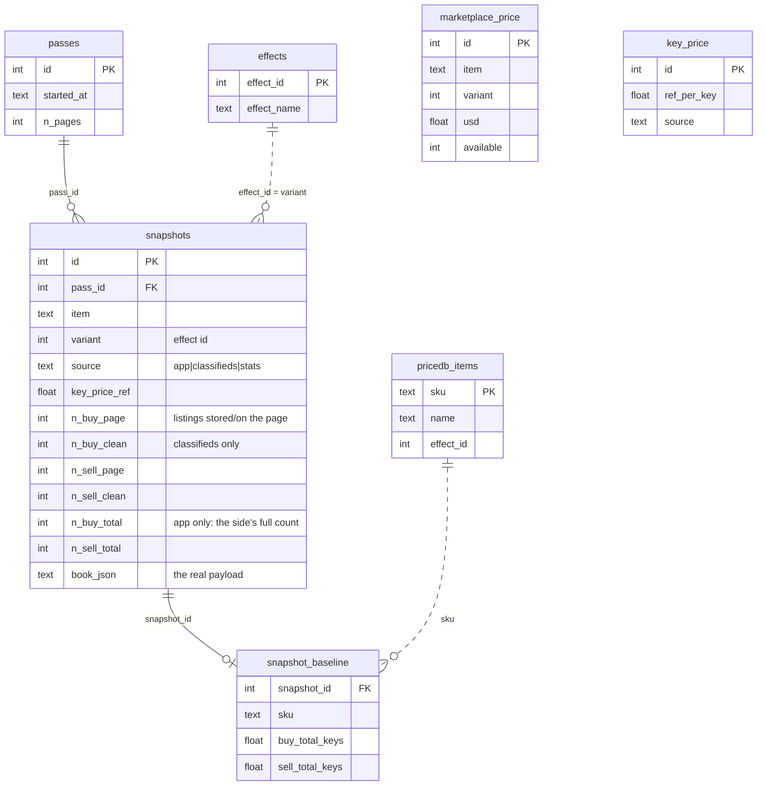

# Data model — `backpack/trading.db`

> **Moved 2026-11-07:** a reference to `data-model.md` for the forecast or its measurements is now
> `forecast-model.md`; one for the bot registry, groups or per-bot features is now `bots.md`.

> The schema and how to read it correctly. Split out of `master-plan.md`
> 2026-09-17. How books were fetched is not in this repository; code module interfaces are in
> `code-base.md`. A number with an old date is suspect — re-measure the DB.

## Governing rule

**Raw capture holds only observed facts; anything involving a rule (filter
Strange, dedupe bots, pick the ask) is derived and droppable.** Rebuilt
2026-09-13 from scratch; the old 17,282-row DB (and its contaminated
`bid_keys`/`ask_keys` columns) is archived under
`backpack/archive/trading_before_schema_rebuild_*`.

## Layer 1 — raw (`snapshots`)

Append-only, one row per `(item, quality, variant)` per pass. Columns: `pass_id`,
`item`, `quality`, `variant`, `effect_name`, `scraped_at`, `ingested_at`,
`source` (`app`|`classifieds`|`stats`), `exist_current`, `priced`, `key_price_ref`,
the four pre-trim counts (`n_buy_page` / `n_buy_clean` / `n_sell_page` /
`n_sell_clean`), the side totals (`n_buy_total` / `n_sell_total`, app rows only),
and the book itself in `book_json`.

**Two row shapes — the scrape endpoint changed on 2026-09-29** (the collector's private notes).

| | `source='classifieds'` (until the switch) | `source='app'` (next.backpack.tf's listing call) |
|---|---|---|
| depth stored | top 7 a side | everything returned, ≤ 30 a side |
| filtered at scrape | buys: spelled/painted/parted dropped (Unusual: Strange/spelled) | nothing — the read rules drop flagged listings |
| `n_*_page` | listings on the page (10 = page full, more exist) | listings returned (30 = capped, more exist) |
| `n_*_clean` | after the scrape filter, before the cap | NULL (a read rule now) |
| `n_*_total` | NULL (never collected) | the side's full count as the site reports it |
| `key_price_ref` | the pass's cached rate | the rate that book was priced at (below) |
| qualities | 5, 6, 11 | 6, 11 only |

**Two databases, side by side (user, 2026-10-02).** App rows go to a fresh
**`backpack/trading_app.db`** (same schema as below, `n_*_total` included), so the two
row shapes never mix; `trading.db` keeps the 766k classifieds rows (2026-09-14 →
10-01) and stays the engine's input until it is switched over. Built from
trading.db read-only: copied **`bot_account`** (530; `first_snapshot_id` set to **0** =
"registered in the old DB", since those ids point at old rows), `bot_group_member`
(618), `steam_profile` (530), `bot_label` (55, the manual marks), `effects` (339),
`pricedb_items` (40,960). **Not copied:** order books (`snapshots`, `passes`,
`snapshot_baseline`, `marketplace_price`); `key_price` (app rows carry their own
`key_price_ref`); `bot_sync` — its watermark is an old snapshot id, so copied it
would make the next `bot_registry sync` skip the first ~766k new snapshots. Since the
merge (2026-10-02, user) everything on the collection side defaults to it: the
launchers (`-Db`), the menu, `last_scrape.py`, `bot_registry.py` (sync / mark) and
`reset_series.py` (menu x). **Since 2026-10-17 the engine reads `trading_app.db` too**
(user, for Stage 6: it has to pick on today's data): `engine.panel.DEFAULT_DB` is the app
db, `--db trading` the frozen history; the two are never mixed (their depth differs and
mixing shifted `exp_ret`, `research/forecast_v2/README.md` §4), each has its own cache
folder (`engine_cache/` vs `engine_cache_app/`), and the bot registry is read from the db
in use. The "legacy view" question is settled by the fence depth rule below (the fence
median reads the top 7), not by cutting app books to 7.

On classifieds rows the stored book is capped at 7 a side, so the pre-trim counts
are the only record of true page depth. **`n_buy_page == 10` means the
classifieds page was full (page size is 10) and more bids exist** — a page-size
fact about our scrape.

No `bid_keys`, `ask_keys`, `buy_count`, `marketplace_*`, `ok`, `exist_peak`, or
`url` — each was dead, constant, or a rule in disguise.

### No derived layer (removed 2026-09-14)

There used to be a materialised Layer 2 (`valid_book` + `listings`, built by
`build_derived()`). Deleted with its extractor: the cleaned bid/ask is a *rule*,
and a rule belongs in the query that reads `book_json`, not in a stored table.
`book_json` holds every input, so nothing is lost — see the read rules below.

## `book_json` — the real payload

**Stored form (2026-10-04).** In `trading_app.db`, `book_json` is a **BLOB: one zstd
frame of the compact JSON**, compressed with a trained dictionary kept in the same
database (table **`book_dict`**: `dict_id`, `created_at`, `trained_on_pass`,
`n_samples`, `dict`). The frame header names its dictionary, so no extra column;
`typeof(book_json)` is `'blob'` (zstd) or `'text'` (plain JSON). `trading.db` stays
plain JSON. **Read it through `book_codec.Codec`** (`Codec.from_con(con).decode(value)`
takes either form) — never `json.loads` directly, and SQL `json_each` / `json_extract`
cannot see inside a compressed book. **Never delete a `book_dict` row**: every book
compressed with it becomes unreadable; a retrained dictionary takes the next id and
old rows keep theirs. A fresh database stores plain JSON until its first full pass
(≥ 500 books), then `scrape_run` trains dictionary 1 from it and compresses
(`book_codec.ensure_dict`). Storing bytes in a `Text` column relies on SQLite's
dynamic typing — a move to Postgres needs a `bytea` column. Look at one book:
`python book_codec.py show <snapshot id>`.

`{sellOrders, buyOrders}`. Every listing carries `user`, `steamId`, `premium`,
`price` (`total_keys` is the decimal to use, **null on unpriced listings**; `keys` +
`ref` are the listed amounts, `ref` written as n x .11 per scrap -- 2026-10-19, pass 202:
97.1% of 109k listed prices are whole scrap, 40 have fractional keys; of otherwise
tradable sells 5.2% are not whole keys + scrap, and no book lost every tradable seller to it),
`listingType`, `dealType`, `strange`, `spelled`, and (additive, 2026-09-14)
`painted`, `parted`.

**App rows (2026-09-29) add** `id` (bp.tf's listing id: sells `440_<assetid>`, buys
`440_<steamid>_<hash>`), `ua`
(`userAgent.client`: the bot software the lister's agent reports — Gladiator.tf,
TF2Autobot, … — self-reported, so evidence, not ground truth; null on 18% of
listings in the trial), `listedAt` (unix s) and `premiumFlag` (bp.tf's real premium
flag). **`bumpedAt` and `lastPulse` (the agent's heartbeat) were stored until
2026-10-04 and are dropped since** (user); passes 1–8, the only ones carrying them,
were deleted 2026-10-05 (user), so `trading_app.db` starts at pass 9 (2026-10-04
22:56 IST). Measured on those passes before deletion: they changed on ~86% / ~81% of listings each
hour, every agent's pulse was < 10 min old at scrape, pulse age did not predict a
listing vanishing (4.0% vs 4.9%), nothing read them, and they were 24% of the
zstd-compressed book.

**The list order is the site's, and it is information** (pass 8, 2026-10-04): priced
listings are in price order on 100% of book sides (best first; unpriced listings sit
out of order — 22% of sides contain one); **48.5% of adjacent pairs share a price, and
within a price the site puts the most recently bumped listing first (99.8%)**. So the
position is what's left of `bumpedAt`; anything that re-sorts a book by price loses it.

**Listing identity across passes** (passes 1–8, hourly pairs): `id` is unique within a
pass and **survives a price change** (110k cases), so it is the key that ties a listing
across passes. ~93% of listings carry over to the next hourly pass, ~6% are new; ~79%
are unchanged in every stored field; `listedAt` resets on ~6% (a re-list, with or
without a price change); 16% of ids vanish for a pass and come back, mostly from
sides with fewer than 30 listings (so not the cap). Books are never identical pass to
pass (< 1%), so storing a book only when it changed saves nothing.

## Storage cost of `book_json` (measured 2026-10-04)

`trading_app.db` grows ~57 MB per pass as written (2,879 books, ~115k listings,
~18 KB a book). Each layout below was built from passes 1–8 with `bumpedAt`/`lastPulse`
removed, and checked by rebuilding pass 8 against the original:

| layout | MB / pass | GB / yr hourly | rebuilds pass 8 |
|---|---|---|---|
| `json.dumps` as written today | 50.9 | 446 | exactly |
| compact JSON (no spaces) | 46.8 | 410 | exactly |
| zlib level 6 | 8.7 | 76 | exactly |
| **zstd level 3 + a 113 KB trained dictionary** | **4.0** | **35** | exactly |
| split tables: listing + state (row only on change) + one row per listing per pass | 5.3 | 47 | exactly |
| spans: a row only when a listing is new / changes / returns | 4.5 | 39 | **no** — order rebuilt by price is right on 13.8% of sides |
| Parquet, one file holding all 8 passes, sorted by book | 1.6 | 14 | exactly |
| Parquet, same, sorted by listing id | 1.0 | 8 | exactly |

Codec time is not the cost: zstd-3 compresses a whole pass in ~0.09 s and
decompresses it in ~0.03 s; `json.loads` of the pass takes ~0.6 s. Why split tables
lose (per later pass): `obs` ~114k rows × 15.7 B = 1.8 MB for ~8 B of numbers each
(row header, cell pointer, page slack); `lstate` ~25–31k rows × ~110 B = ~3 MB, the
biggest part, because any change rewrites the whole state row with its text (`ua` ~40
chars, `user` ~15, `raw` ~10, `dealType` 7) although 70% of changes are the price
only and 50% `listedAt`; `listing` ~6k rows × 117 B = 0.5 MB (the 37-char `id` is
stored twice, table + unique index). SQLite stores every value uncompressed, and
the split removes repeats only across passes of one listing, while zstd removes
them anywhere (the same bot name / `ua` across a book and across books). Parquet is
the split done columnar: strings become dictionary ids, runs and deltas are encoded,
then each column is compressed, and a file holds many passes. But a file is write-once,
so it suits a nightly roll-up of finished days, not the scraper's per-book writes.
The zstd dictionary was trained on pass 1 and still fit pass 8 (4.46 vs 4.21 MB
retrained, with all fields).

**Chosen: zstd + dictionary, live since 2026-10-04** (user; `book_codec.py`, the
stored form above). Migrating passes 1–8 (dictionary 1, trained on pass 8): **472.7 →
63.9 MB on disk**, books 430.7 → 33.2 MB (18.7 → 1.4 KB a book), all 23,032 books
checked equal to the originals. The rest of the file (~30 MB) is the copied side
tables plus each snapshot's metadata and baseline row. **2026-10-05:** after passes
1–8 were deleted, dictionary 2 (trained on pass 28) compressed 5–7% better than
dictionary 1 (trained on pass 8, which still had `bumpedAt`/`lastPulse`); all 57,580
books (passes 9–28) were recompressed with it, each checked, and dictionary 1 was
removed once no row used it. Books ~3.2–3.3 MB a pass (1.1 KB a book); the whole file
grows ~5.8 MB a pass (~140 MB a day hourly). A Parquet roll-up of finished days is
the next step if size or read speed calls for it.
**`premium` keeps the old page's meaning — a coloured name**
(`bool(user.customNameStyle)`, 100% agreement with the old parser; the real flag
agrees only 88.6%), because the fence's `trust` was tuned on it. `listingType`:
`friend` if trade offers are off, else `bot` if an agent is present, else `normal`
(99.62% agreement). `dealType` = `instant` iff `buyoutOnly`. The flags come from
`elevatedQuality` / `spells` / `paint` / `strangeParts`. `price.usd` is null;
`price.raw` is the site's own text (`value.long`).

## Quality is part of row identity (liquid items, 2026-09-14)

A base item exists in several qualities at once (a Unique and a Strange "Team
Captain" are different markets). `snapshots` carries a **`quality`** integer
(Valve id: Unusual 5, Unique 6, Strange 11) and the identity is
**`(item, quality, variant, scraped_at)`** (unique constraint
`uq_snap_item_quality_variant_time`). Liquid items have no effect →
**`variant = 0`** sentinel (real effect ids are never 0), `effect_name` null.
The `painted`/`parted` booleans are recorded on every listing; the *fetch* and
*roster* mechanics are in `collector/scrape_run.py` and `snapshot_store.py`.

## Which good: the kind columns and the roster (2026-10-31)

Since the wider roster (user, 2026-10-31) the collector watches every good on bp.tf's
pricelist priced 5 ref to 10 keys, in every quality the app route serves (Genuine 1,
Vintage 3, Unique 6, Strange 11, Haunted 13, Collector's 14), craftable or not, all types.
Several goods share an `(item, quality)`: a Non-Craftable Team Captain is item `Team Captain`,
quality 6, like the craftable one. So `snapshots` and `watch_snapshots` carry five **kind
columns**. Each defaults to the plain good, so every row from before them reads as what
it is:

| column | default | meaning |
|---|---|---|
| `craftable` | 1 | 0 = Non-Craftable |
| `elevated` | 0 | 11 = Strange-elevated (a Strange Haunted cosmetic is quality 13, elevated 11) |
| `australium` | 0 | 1 = an Australium weapon (item = the base name, `SMG`) |
| `crate` | 0 | a crate / case series number (`Mann Co. Supply Crate` #10 = crate 10) |
| `target` | 0 | a Strangifier's target defindex (bp.tf's priceindex; item = `Strangifier`) |

**The read rule.** A read of a series by `(item, quality)` must also pin the kind, or it
mixes two goods. The engine reads the **plain good only** (all five at their defaults,
`engine.panel.plain_sql`); its series key stays `(item, quality, variant)`. A good's own
kind is asked for, and checked against the server's echo, by the collector
(`bptf_app.Kind`); listings of other goods never enter a book. Strict books also exclude
Australium, killstreak and festivized listings. The 2,881 legacy books are strict too
since pass 490 (2026-10-31, the user's Q12). Before that they let in a few: on pass 489,
22 books held 41 such listings (39 killstreak, 2 festivized), the top buy order in 4.

The per-group backtest (`engine groups`, 2026-11-01) reads every other good too. Each kind
is its own series, with a negative in-memory `variant` packing its kind (`engine.kinds`;
code-base.md, "Every good, kinds apart"). The db's `variant` stays 0. **A Strange-elevated
good's listings all carry `strange`** (measured 2026-11-01, pass 499: 365 of 365 listings in
the 33 elevated books; 0 of 45,948 in the Strange-quality books). Read rule 1 drops
`strange` as a different good, so the engine reads an elevated good's book with that flag
cleared (`kinds.as_good`). The collector already asked for `elevatedQuality=11`, so every
listing in it is the good.

**How scorable the new groups are** (measured 2026-11-01 on passes 489–500, the first 12 of
the wider roster). The measure is the share of books two-sided with the ask within 5% of the
best bid: the forecast's universe. The admitted Unique and Strange cosmetics: 57% and 58%.
- Unique taunts 83%, Strange melee 69%, Strange secondaries 66%, Genuine cosmetics 52%.
- Strange primaries 47%, Unique tools 45%, Non-Craftable tools 31%, crates 26%, Haunted
  cosmetics 18%.
- Non-Craftable Unique cosmetics 2% (277 goods; two-sided only 24% of the time),
  Strangifiers 4%.
- Never scorable: Strange-elevated Haunted cosmetics (two-sided 4%), and the 17 Strange
  Non-Craftable cosmetics, which never had a sell listing. Whether that is the market or
  the request is not checked yet.

**`roster`** (trading_app.db, synced in `changed` mode on `changed_at`): one row per good the
collector watches, never deleted. Columns: `item`, `quality`, the five kind columns,
`target_name`, `full_name`, `defindex`, `type` (the spreadsheet's Type: Cosmetic, Taunt,
Tool, Primary, ...), `origin` (`legacy` = watched before 2026-10-31, seeded from the books;
`band` = added by the price band), `admitted`, `price_ref` (community price at the last
pricelist load), `added_at`, `last_seen`, `changed_at`. The unique key is item + quality + the
kind columns. On 2026-10-31 (a rehearsal on a copy of the db): 4,457 goods, 2,881 legacy +
1,576 band (Unique 946, Strange 206, Haunted 180, Genuine 159, Vintage 85; 511
non-craftable, 33 elevated, 63 crates, 27 Strangifiers, 3 Australium).

**`admitted`** is the trading gate. The engine reads only goods with `admitted = 1`
(`engine.panel.universe_sql`), so the collector watches more than the agent can trade:
- Admitted at the start: the 2,881 legacy goods and the 103 band goods that are craftable,
  plain Unique/Strange cosmetics.
- Never admitted: Mann Co. Supply Crate Key and the metals, which the agent spends as currency.
- Every other group (type × quality, elevated counted as its own, × craftable × Australium)
  waits for a backtest on 7 days of its own data. The user then sets `admitted` on the VM
  (the only writer).
- An empty roster (not seeded yet) gates nothing.

## Side tables

`marketplace_price` (item, variant, observed_at, usd, available — fed by the
slower stats pass); plus `passes`, `effects`, `pricedb_items`,
`snapshot_baseline`, `key_price`.

**`trade_url`** (trading_app.db, since 2026-10-17) — one row per lister: `steam_id`
(PK), `url` (its Steam trade-offer link, `https://steamcommunity.com/tradeoffer/new/
?partner=…&token=…`), `first_seen`, `changed_at`. The app serves every listing's
`user.tradeOfferUrl` (the account's own saved link). Measured on the first pass that kept
it (pass 159, 2026-10-17): 96.5% of listing accounts have one, 98.6% of bot + instant
accounts (425 of 431), covering 99.6% of their listings; the collector keeps it here, per account, not
in `book_json`. Written only when new or changed (a null never overwrites a stored URL),
synced in `changed` mode on `changed_at`. Stage 6 needs it: an offer to an account that
is not a Steam friend must carry the token.

**Tradable listings vs the model's prices** (measured 2026-10-19, pass 202, the 1,466
universe books; `engine.listings`, Stage 6 step 3.1). The model buys at `ask1` (the
cheapest fenced seller, any kind) and sells at `bid1_fill`; the agent may only deal with a
fenced `bot` + `instant`, trusted listing with a trade URL. Buy side: the cheapest
tradable seller **is** `ask1` in 92.4% of books; in **7.6% it is dearer, by a median 3.45%**
(max 20%) -- more than a pick's whole expected return, so the agent must not buy a pick
whose tradable price is above `ask1`. Sell side: the best tradable bid is `bid1_fill` in
97.4%; in 2.6% it is lower, median -0.8% (max -8.6%). Every universe book had at least one
tradable seller and buyer. One pass only; the backtest's exits happen at later passes.

**`watch_snapshots`** (trading_app.db, live on the VM since 2026-10-18 13:55 UTC) — the ~10-min watch of held
items (handoff Phase 2.2). The same raw row as `snapshots` (`item`, `variant`, `quality`,
`scraped_at`, `ingested_at`, `source`, `key_price_ref`, `n_buy_page` / `n_sell_page` /
`n_buy_total` / `n_sell_total`, `book_json` — same codec, read it through
`book_codec`), minus the pass fields: no `pass_id` (a tick is not a pass), no pricedb
pairing, no `exist_current` / `priced` / `effect_name` / `n_*_clean`. Unique on
(item, quality, variant, scraped_at). `reason` (since 2026-10-18 15:28 UTC): `'tick'` (the
10-min watch) or `'check'` (the agent's price check before an offer, `book_server.py`);
NULL = a tick from before the column. What it watches is `collector/watchlist.json` on
the VM (edited with `watchlist.py`, re-read every tick); an empty list writes nothing.
An entry's `entry_keys` (the ask paid) arms the take-profit alert (`held_alert.py`); it is
not stored in the DB.
Its own table so the hourly passes stay one row per item per pass: a reader that joins
the two must not count a watch row as a pass. Synced to the PC in `append` mode (since
2026-10-18).

## Bot registry, groups and per-bot features

Moved to [`bots.md`](bots.md) (2026-11-07).

## The agent's ledger (`backpack/agent.db`, Stage 6 step 3.6, 2026-10-19)

Its own SQLite file, not `trading_app.db` (a read-only replica of the VM). The deleted paper
agent kept the same schema in `backpack/agent-paper.db` (mode `paper`;
`docs/extra/paper-agent.md`). Written only by
the Node agent (`agent/lib/ledger.js`, which also creates the schema); read by Python
(`engine picks --ledger`: what is held). Gitignored with `backpack/*.db`.

- **`positions`** — one row per item bought: `mode` (`paper` / `live`), the series
  (`item, quality, variant`), `state` (`opening` → `open` → `closing` → `closed`; a buy
  that does not fill → `abandoned`; a sell that does not fill → back to `open`), the model
  at entry (`pass_id, exp_ret, p_up, ask1`), `entry_keys` (what the buy pays -- reset at
  the fill to the offer that filled), `take_profit_at` (entry × 1.04), `horizon_at` (the fill
  + 48 h; opened + 48 h until then), `asset_id` (the item's id
  in our inventory once held: a trade gives it a new one), then `closed_at, exit_keys,
  exit_reason, pnl_keys`. **Held** = `opening`, `open` or `closing`: never two at once.
- **`offers`** — one row per offer built, several per position when a bot does not answer
  and the next one is tried (2026-10-26): `kind` (`buy` / `sell`), `position_id`, `state`
  (`built` → `sent` (on Steam, waiting for our confirmation) → `active` (confirmed, delivered:
  the 30 s run from here) → `accepted` / `declined` / `expired` / `canceled` / `failed`;
  `escrow` if Steam holds it; `would_send` = the paper agent's, old rows only), `partner`, `trade_url`,
  `listing_id`, the price (`price_keys, price_ref, total_keys`), `receive_json` /
  `give_json` (the asset lists), `watch_id` (the VM's `watch_snapshots` row the price was
  checked on: the book it was priced against), `steam_offer_id`, `reason`.
- **`offer_events`** — every state an offer went through, with its time: `sent` →
  `accepted` is the fill time the backtest assumes is zero.
- **`position_events`** (2026-10-30) — every change made by hand to a held (`open`)
  position, from `engine panel` or `agent sell / tp / horizon`: `what` (`sell_now` = the
  horizon moved to now; `take_profit`; `horizon`), `old_value`, `new_value`, `detail` (who).
  `engine exits` reads `take_profit_at` / `horizon_at` every cycle, so these edits are the
  whole override -- no other code path. A sale whose last horizon change was a `sell_now`
  closes with `exit_reason` **`manual`** (beside `take_profit` / `horizon`), so the report
  never counts the user's exits as the model's.
- **`conversions`** (2026-10-30) — one row per key<->metal offer of the rebalance
  (`agent/lib/convert.js`): `kind` (`buy_key` / `sell_key`), `state` (the offers' states and
  moves), `partner`, `trade_url`, `listing_id`, `price_ref` (one key, in ref),
  `receive_json` / `give_json`, `watch_id`, `steam_offer_id`, `reason`; its states in
  **`conversion_events`**. Not a position: no P&L, never in the win rate, `exposure` or the
  picks' held list. Its open offers' assets are reserved like any offer's, and the restart
  check reads them back from Steam the same way.

Only the moves in `OFFER_MOVES` / `POSITION_MOVES` are allowed; an offer's end state moves
its position (buy accepted → open, sell accepted → closed with `pnl_keys`), except a failed
end with `final: false` (another bot is tried next; `giveUp` ends the position after the
last). Offers carry no Steam message (user, 2026-10-30): the restart check finds an offer the
agent stopped around by its partner + exact `give_json` / `receive_json` asset ids, skipping
Steam ids the ledger already has, newest first.

## Joins

`snapshots.id` is the key; `snapshot_baseline.snapshot_id` points back at it.
`pass_id` groups a sweep (~1,157 rows); `snapshot_id` identifies one book.

Solid lines are real foreign keys on `snapshots.id` / `pass_id`; dotted lines are
logical joins (`variant` = `effects.effect_id`; baseline SKU ↔ `pricedb_items`).
`marketplace_price` and `key_price` stand alone — joined by (item, variant) and
by time, not by row id.

## Reading the valid book from `book_json` (the rules)

The numbers everything downstream uses, computed on read. **The code for these
rules lives in exactly one place, `backpack/engine/book.py`** (`read_book`); bump
its `RULES_VERSION` when a rule or parameter changes. In order:
1. drop Strange or spelled, **and parts (`parted`) or `painted`** — each is a
   different good, and the flags leak (a marked Parts-Attached bid is a common
   high-side contaminant); even when the server filter already applied. Also drop
   every listing of a **level-2 untrusted account** (`engine.book.UNTRUSTED`, user
   2026-09-26 — none yet; see "Untrusted accounts");
2. dedupe by `steamId`, keep best price (one bot posting twice is one vote) —
   the highest for a buy, the lowest for a sell;
3. filter out null `total_keys` before ranking;
4. **fence around the book median `m`** (needs ≥3 valid listings a side), `m` taken
   over the **top `FENCE_DEPTH` = 7** valid listings of the side only (RULES_VERSION 4,
   2026-10-17). Why: every factor below was tuned on classifieds books, which stored the
   top 7 a side; an app book carries up to 30, and the median over all of them sits near
   the 15th — measured on the latest pass p157 (2026-10-17 18:00, 2,880 books): the top-7
   buy median is ≥ 1.08× the all-listings median in 10% of books, ≥ 1.40× in 1%, and the
   depth changes which listings are kept in **194 buy books (6.7%) and 618 sell books
   (21%)**. With the old rule, `1.02 × m` fenced out whole trust-0 clusters at the top
   (D-Eye-Monds: top-7 median 0.151, all-30 median 0.093). The fence still applies to
   every valid listing, so the deep ones stay in the depth features (`n_buy`,
   `n_near_top`, the bot observations). On a ≤ 7-deep book (all of trading.db) it is a
   no-op.
   - **buy:** keep bids in `[0.40, k_hi[trust]] × m`, `k_hi = (1.02, 1.10, 1.20)`
     for trust 0/1/2 (was a flat 1.35 until 2026-09-24, see below). The high cut
     strips premium/combo buyers, leaked different goods, rival-provider bots and
     untrusted high bids above the dominant cluster. Example (2026-09-24, Big Steel Jaw of Summer Fun, Unique): one
     50-key bid over five bots at 0.0214 — unfenced top-5 mean 10.02 keys,
     fenced 0.0216. 54 of 2,830 latest-pass books had an unfenced bid >10% above
     the fenced one.
   - **sell:** trust-modulated low cut. `trust = (listingType == "bot") +
     premium ∈ {0,1,2}` — bp.tf's own bot badge plus the premium flag. Keep a
     listing if `price ≥ k_lo[trust] × m`, `k_lo = (0.95, 0.60, 0.35)`, and
     `≤ 1.5 × m` (tightened 2026-09-24, see below). Untrusted lowballs ("restarted" sellers) drop; a genuine cheap
     bot sell survives.
   - Tuned on **Strange (11) + Unique (6)** only: 97.6% of buy books sit within
     1.25× median; trust-0 asks lowball constantly (18.8% >10% below median)
     while trusted bots almost never do (0.4%). Unusuals are untuned.
5. if nothing survives, there is **no computable price** (missing, not zero,
   not a stale carry-forward);
6. everything is decimal keys (`total_keys`), with `key_price_ref` on the snapshot.

The derived prices: **bid1** = best fenced bid, **bid5** = mean of the top-5
fenced bids, **ask1 / ask5** likewise from the lowest fenced asks. Added 2026-09-25
for the Stage-5 forecast (read-outs, no rule change): **bid_med / ask_med** = the
median of the fenced bids / asks (the "buy-order level") — since 2026-10-17 those among
the top 7 valid, the same depth as the fence and as the classifieds books it was built
on — **ask1_bot** = the lowest fenced ask from a bot-badged listing (an instant buy).

Known limits of the fence: the rival-provider bids it drops above the cluster are
clean bots (a modelling choice: report the consensus, not the absolute best bid);
a trust-0 ask a bot would insta-buy is a real-but-fleeting arb blip, dropped from
the ask.

**A thin bimodal book fences out its real top (measured 2026-10-18, trading_app.db).**
Resurrection Associate Pin (Unique), p146 and p149: four bots of one naming family (⚡️ Rem ⚡️,
Gir ⚡️, Hhanuska, 24our7even — ~1,100 buy listings each, still present across the rest of
the market in those passes) pulled their ~1.31-key bids from this one item together, and
came back together (p148; p157 at 0.95). Left: 4 valid bids, 1.33 / 1.33 / 0.84 / 0.69,
so the median falls in the gap (1.08) and both 1.33 trust-2 bot bids sit at 1.23× > 1.20× —
fenced as fliers. bid1 and `bid1_fill` read 0.84 while two fillable bids stood at 1.33.
Over every book of p146–p159 (40,228 with a buy median): a **cluster** (≥ 2 accounts within
2% of each other) is fenced too high in **0.9%** of books, but in 2.5–5.9% of thin ones
(4–9 valid bids), against 0.6% at 10+. Some of those are the deliberate rival-provider
cut above; on a 4-bid book there is no consensus to protect. Who the four are (measured
p146–p159): all run **TF2Autobot** (`ua` = "TF2Autobot - Run your own bot for free"),
premium, bot + instant, ~1,000–1,100 buy orders each. Pulling an item is their **routine
hourly churn, in sync**: each drops ~50–80 items and adds ~50–75 a pass, and **~30 of those
are the same items for all four** (independent picks of 55 from ~1,100 would share ~0).
Co-bid prices match 56–71% of the time, about the market-wide 57.9% (median-following),
so price alone does not mark them. Separately, a whole account blinks out for one pass and
returns (Hhanuska −635 / +630 at p150–152, 24our7even −1,057 / +1,062 at p154–156, Gir −461
at p153–154): a restart or outage.

*What the four share (measured 2026-10-18, p146–p159; TF2Autobot source read the same day):*
- **Not a public feed, not a stock limit, not pricedb.** Drop-sync lift (P(B drops | A
  drops) / P(B drops), items both bid on): **6.1 among the four**, median **0.0** against
  the 6 other big default-`ua` TF2Autobot bots, ~1 for everyone else (closest outsider 4.8).
  2.1% of drops come with a new sell listing of the item (max stock ruled out). Their bids
  equal pricedb.io's buy price 25–33% of the time — the median-following rate, not a
  pricedb pricer.
- **The drops are real deletions.** Of drops back the next pass, 98% were re-created after
  our look (new `listedAt`, a median 21 min later); 47% come back at a higher price, 37%
  the same, 16% lower. TF2Autobot (`src/classes/Listings.ts`, `checkByPriceKey`) removes a
  buy listing only when the pricelist has no enabled price for the item, when stock is
  reached, or (option off by default) when it can't afford it; a price change is an
  in-place update. So a delete-and-recreate means the item lost its price for a while.
- **Two rhythms.** Each bot rebuilds its whole book in two ~15-min waves every 12–18 h
  (Rem 00:12 and 18:33, Hhanuska 00:12 and 12:13, 24our7even 00:17 and 16:02, Gir 03:13
  and 15:14 UTC) — restart-like, staggered, three of them within 5 min at midnight. And
  ~5% of buy orders an hour are deleted and re-created one at a time.
- **Same-second actions.** Gir, Hhanuska and 24our7even re-create the same item's listing
  within 60 s of each other 16–18% of the time (within 10 s: 4–8%). Other TF2Autobot or
  TF2AutobotPriceDB pairs: 0–1%; Gladiator pairs, one hosted service: 0–20%. (Rem can't be
  measured — every listing was new after its 18:33 rebuild.)

Reading: a per-item event reaches these bots within seconds and reaches no other TF2Autobot
bot — the fingerprint of **one operator or one shared private setup (machine / pricer)**, at
the strength of Gladiator's own fleet, rather than a public price feed. Not proven: the
pricer's own update times (prices.tf needs a token; no history route found) or a faster
watch of these accounts would settle it. Gir, Hhanuska and 24our7even are all in the
`tf2automatic` Steam group, Rem is not — the group is too big (16,796) to mean much. The registry calls Gir and Hhanuska `unknown` (not in the TF2Autobot Steam
group) although their `ua` says TF2Autobot: the provider rule does not read `ua`. Open for the user: whether the sale read
(`bid1_fill`) should keep a fenced-high cluster of trust-2 instant bots.

**Rule audit, latest pass p157 (2026-09-24, 2,870 Unique+Strange books).** Every
stored listing through `engine.book.explain_book` (the dashboard's Book audit tab):
- **buys** — 16,699 kept; 136 in books with <3 valid bids (no median), 74 fenced
  high, 9 fenced low. **No buy is dropped by a flag** — the classifieds buy leg
  already excludes those goods at source.
- **sells** — 16,693 kept; **1,441 painted** and **290 parted** dropped (the bulk of
  sell-side cleaning), 274 no median, 188 null price, 28 fenced high, 28 low, 9
  duplicate accounts.
- **2,826 of 2,870 books had a full buy page** (`n_buy_page` = 10) while the stored
  book keeps 7 a side — so the median/fence sees only the stored 7.
- **bid1 is set by a non-bot account in 165 books (5.7%)** — the buy fence has no
  trust term, so a human premium bid above the bot cluster sets the top bid.
  → *Addressed the same day: the buy fence is now trust-modulated (RULES_VERSION 3).*
- ask5 > 1.3 × ask1 in 19 books (0.7%): the sell high cut (3 × median) is loose
  enough that a far ask can sit in the ask5 mean.
  → *Addressed the same day: sell high cut is now 1.5 × m (RULES_VERSION 2).*

**Sell fence tightened 2026-09-24 (`RULES_VERSION` 2):** trust-0 `k_lo` 0.75 → **0.95**,
high cut 3 → **1.5 × m**. Why: a trust-0 *negotiate* ask at 0.76 × median set Fat
Friar (Strange)'s ask1 at 0.6196 for days under a bot cluster at 0.8106. Measured
over the last 24 passes (63k books): trust-0 accounts set ask1 in **12.6%** of
books (35% of those are negotiate listings), sitting at a median 0.93 × m; 0.95
changes ask1 in 8.9% of books (0.90 would have been 4.1%). 817 kept asks sat in
1.5–3 × m (166 above 2×), inflating ask5. The bot-only median was tried and moves
ask1 in only 0.1% of books, so the cuts, not the median's base, were the lever.
New-high backtest after the change: precision@10 35.7%, @25 32.4% (was 30.3%).

**Buy fence made trust-modulated 2026-09-24 (`RULES_VERSION` 3):** high cut from a
flat 1.35 × m to **1.02 / 1.10 / 1.20 × m** for trust 0 / 1 / 2. Why: a trust-0
*negotiate* bid at 1.17 × m (5.000 keys over a 4.282 bot cluster, and above the
4.397 ask) set Soldier's Stash (Unique)'s bid1 at p103 and faked a new-high step.
Measured over the last 24 passes (68k books): bid1 came from trust 0 in 2.0% of
books (median 1.045 × m, 90th pct 1.23 ×), trust 1 in 4.7% (median 1.011 ×, 97th
pct 1.137 ×). The new cuts change bid1 in 2.0% of books (932 were trust-0, 199
trust-1, 251 trust-2) and newly drop 357 trust-2 bids in 1.20–1.35 × m. Signal-check
afterwards (data had also grown to 138 labelled passes): new-high precision@10
43.3% vs 7.2% base (8.0×); any-step precision@10 80.0% (6.0×).

Open, not in the KB: in ~17% of books the fenced bid1 ≥ the fenced ask1 (a crossed
book) — 11,208 of 67,545 over the last 24 passes, 10,067 of them with a trust-2
bot setting bid1 (measured under the old flat buy fence; ask trust not checked).
Why is unknown — worth a look in the dashboard before trusting `spread` near zero.
Who sets bid1 in crossed books (measured 2026-09-24, last 48 passes, 20,997 crossed of
123,856 two-sided books = 17.0%; RULES_VERSION 3): **210 accounts, top 10 = 35%**, and
the top setters are mainstream long-lived bots bidding **at the median (~1.000×)** across
~190–290 items each, present in 46–48 of 48 passes (e.g. Sailor Moon (Real!), Fast,
Testing! :D, BuzzyBee, ZeBro, XmaS Bot). So most crossing is **not** rogue bids — the
ask side sits *below* the normal bot bid cluster, cause not in the KB. A second, smaller
class *is* overbidding: accounts consistently ~4–8% over the median on a narrower set
(🔧Lia 1.043× / 55 items, [BOT] Deer's Stuff 1.043× / 64, 🐊Bombino Crocodilo 1.044× /
111 and present in only 31 of 48 passes, CASECASE… 1.083× / 31) — inside every trust-2
cut, so only an account-level signal (not the median) can separate them.

**Crossed books under the fill rule (measured 2026-09-26, passes 50–179, 9,672 crossed
of 337k two-sided books = 2.9%; RULES_VERSION 3).** The user's fill rule (any order
inside its fence fills instantly at its price) would make every crossed book an instant
arbitrage — buy the fenced ask1, sell into the fenced bid1: median gap **+1.7%** (bot
on both sides, 49% of them: +1.1%; a human ask, 44%: +2.2%), **~1.3 keys per pass**
summed over the crossed books — some 15× what the forecast portfolio made in five
days. Yet the crossings **persist**: 2,766 episodes, median 2 passes, 90th pct 8, max
26 (a day); the crossed ask is still there at the same price the next pass 83.5% of the
time (any ask: 78.6%). Nobody takes them — not the bots bidding above. So something
stops these fills that the rule does not model (bot stock limits, listing details the
book does not show, a human seller who must accept, …) — **not in the KB**; it is a
question for the user, and a reason to hold the rule loosely at the edges. The
forecast keeps crossed books out of its universe.
*Answered by the user (2026-09-26):* some bots keep a sell listing up after they no
longer have the item (sold it already), and some listings come from genuinely broken
bots that do not accept a trade even when you send one — so parts of the book are
stale, and a crossed book is mostly that. Their advice: **don't focus on it**. Crossed
books stay out of the universe; no further work planned on them.

### Untrusted accounts (user, 2026-09-26)

**The list** (`engine.book.UNTRUSTED`, user decision 2026-09-26): only accounts judged
untrustworthy **that get past the median fence** — the user: "the specific list for bots
which often got past the median formula"; an account the fence already rejects needs no
entry — each with a level ("by how much", not a score for every account):
- **level 1 — never a fill**: the account stays in the book and the fence, but a trade
  with it does not go through; `bid1_fill` skips it, so the forecast never sells into it;
- **level 2 — out of the book**: dropped at rule 1, before the median and the fence (and
  so never a fill either).
**How an account gets on it:** `python -m engine untrusted` (`engine/untrusted.py`)
measures candidates and suggests a level; the user confirms each one, then it is added
by hand. The rule (agent-chosen, each a parameter): over the last 48 passes, in books where
a median forms, an account's **pass rate** = the share of its bids the fence keeps
(`bot_obs.kept`), and on those kept bids its **overbid** = bid / the book's median valid
bid. A candidate gets past ≥ 50% of the time with a median kept overbid ≥ 1.03 across
≥ 20 items; suggested level 2 at ≥ 1.10×, else 1. Buy side only (a low sell is a cheap
seller, which the sell fence already weighs by trust). Editing the list changes
`READ_KEY`, and every cached book read rebuilds.

Run on 2026-09-26 (passes 143–190) — on the list: Deer's Stuff past 99%, kept overbid
1.032× over 68 items, the best kept bid in 97% of them; Bombino Crocodilo past 99%,
1.003× over 271 items (its overbid has come down since 09-24). **Candidates, awaiting the
user:** CASECASE… ([Steam ID removed]) past 100%, **1.083×** over 35 items, bid1 in 100%,
suggested 1; ☮ Pacifysto ☮ ([Steam ID removed]) past 82%, 1.032× over 28 items, bid1 in
70%, suggested 1.

*A first version of the rule (same day) measured the overbid on every valid bid, before
the fence, and so proposed accounts the fence already catches.* Its top one, **DuckMann**
([Steam ID removed], 6.56× across 29 items), was added at level 2 and taken off again
within the hour: of its 817 books the fence rejected 620, 193 had too few bids for a
median, and it got past in **4** (all 3-bid books). The user's explanation of it stays a
fact: *"Duckman buys spelled but doesn't mark it"* — an unflagged different good, which
rule 1 cannot see (10 keys on a 0.02-key Viking Braider). Where it does get through (thin
books) the forecast's misread guard handles it.

**Level 1 so far** — two accounts whose trades do not reliably go through (user: "these two provide unstable
trades; rest assume all trades are instant"): 🐊Bombino
Crocodilo🐊 and [BOT] Deer's Stuff ✨. (The public copy ships `UNTRUSTED` empty: their Steam IDs are left out.)
They are two of the overbidders found on 09-24 (~1.04× the median across 50–110 items)
and together took 46 of the forecast's 134 take-profit sales ("Who the trades face").
Measured over passes 142–189: **buy orders only** (2,306 and 783 listings, no sells);
the fenced bid1 in 1,970 of 134k books with a bid (1.4%), strictly above the next bid in
1,516. Their orders stay in the book and the fence (the rules are unchanged); the read-out
`bid1_fill` = the best fenced bid from any *other* account is what a sale gets, and the
forecast sells only into it. Every other account's order fills instantly (the fill rule).

`strange_top_bid` is **not** derivable — the classifieds buy leg excludes Strange
at source, so strange bids never reach `book_json`; that feature needs its own
capture leg.

**Strange Unusual has no `quality` value of its own** (measured 2026-09-24).
`snapshots.quality` is only 5 / 6 / 11. A Strange Unusual shows up solely as
`strange=true` **sell** listings inside `quality=5` books — 599 of 10,051 Unusual
sells (~6%) over the last 6 passes, and **0** buys. So there are four markets
(Unusual, Strange Unusual, Strange, Unique) but only three have a two-sided
book; Strange Unusual is ask-only until it gets its own capture leg. The strange
flag never fires in `quality=6` or `quality=11` books (0 of ~4.7M listings).

Analysis-time rules that ride along: **group by `pass_id`, never timestamp**
(`scraped_at` is per-page, spread over 2–4 min); label horizons in **wall-clock
hours, never pass index** (passes can be empty or gapped).

## Bid step-up events (the Stage-4 target)

Decided 2026-09-24, implemented in `backpack/engine/events.py`. A **step** is a
snapshot where the series' **bid1** (top-1 fenced bid — a ratchet is the best bid
stepping, the top-5 mean blurs it):
- rose **≥ 2%** over the series' previous pass, that pass being **≤ 3 h** earlier
  (a longer gap is not "the previous pass"), and
- **holds** on the next pass (next bid1 ≥ 0.99 × this bid1, also ≤ 3 h later).

The label `ev_<H>h` = a step within the next H wall-clock hours (H is a
parameter). It is **NaN, not 0,** when the series has no observation at or
after t+H — censored rows would bias every rate down. **A collection gap censors the
same way** (2026-10-17, `events.observed_until`): where no pass ran for more than 6 h
(`SEGMENT_GAP_H`; trading_app.db's 6-day gap before pass 133, when the Azure VM started)
a window reaching into the gap is NaN, for these labels and the forecast's `up_` /
`ret_` alike. A gap in one series while passes ran is still data (the item was missing).

Measured 2026-09-23 over 366k Unique+Strange snapshots (150 passes, ~hourly,
median gap 1.0 h, max 80 h):
- bid1 is unchanged in 76% of passes, up in 19%. The median up-tick is +0.22%
  ≈ **0.0017 keys ≈ 1 scrap** — the bot undercut race, which the 2% bar filters.
- ≥2% rises: 2.2% of passes (≥5%: 0.8%, ≥10%: 0.27%); 80% hold the next pass.
  Steps ≈ 0.29 per item-variant per day. Median bid1 is 0.25 keys (~16 ref).
- **63% of steps are recoveries, not new highs** (measured 2026-09-24): the new
  bid1 is ≤ the series' max bid1 over the prior 24 h. Only 37% set a new 24 h
  high. So a "step" as defined is mostly a flickering book (the top bidder
  drops and returns); the ratchet proper is the new-high subset.

**New high** (added 2026-09-24): a step whose bid1 also exceeds the series' max
bid1 over the prior 24 h (strictly earlier passes; `bid1_max24`). Its label is
`nh_<H>h`, computed beside `ev_<H>h`; screens take `--new-high`. The two events
are predicted by *opposite* things (signal-check, 24 h, measured 2026-09-24):
- **any step** (base 17.6%): the bid just **dropped** (`bid_chg_1p`/`_6h` low,
  `bid_vs_24h_high` low) and a step came recently — mean reversion, the flicker.
  Backtest precision@10 72.6% vs 12.1% base.
- **new high** (base 7.2%): sell-side junk being fenced (`n_sell_fenced` high,
  2.7×), a **wide spread**, and the bid **and ask rising** over 6–24 h —
  continuation. Backtest precision@10 35.3% vs 5.1% base (6.9×).

## Buy-level forecast (the Stage-5 model)

Moved to [`forecast-model.md`](forecast-model.md) (2026-11-07): the labels, the features, every
backtest, `p_up` at the top, feature drift, "What the picks are".

## Bot purchases and the asset-id clock (measured 2026-10-02)

**Purchases inferred from the book (`trading.db`, last 140 hourly passes).** A bid that
vanishes while still above the lowest stored bid, followed by a sell listing from the same
account on that item in the next pass, is a likely purchase:

| | count | sell appears next pass |
|---|---|---|
| bid vanished | 158,869 | **2.2%** (3,426) |
| bid stayed (control) | 1,580,009 | 0.09% |

About 140 of the 3,426 (4%) are expected by chance. Rank 1 shows it at 3.1%, rank 2 at
2.5%, rank 3 at 2.0% and rank 4+ at 1.5%. Another 0.97% show the sell listing one pass
later. **Markup** (the new sell price ÷ the last bid): median +3.1%, p25 +1.1%, p75 +7.6%,
p90 +17%. It's biased low, because a sell priced above the 7 stored asks isn't seen. Most
vanished bids (97.8%) show no sell listing.

**Asset ids are a clock.** A TF2 item gets a new, larger asset id each time it changes
owner, from one counter that only climbs:

- **Per owner change:** in 24 item histories (the site's item-history pages),
  167 of 167 owner changes came with a larger id.
- **Across all bounds:** 0 contradictions over 2015–2026 between 167 "still with the
  previous owner at t" lower bounds and 55,143 "already existed at t" upper bounds (item
  histories, plus `listedAt` of 54,952 sell listings in `trading_app.db`, whose listing id
  is `440_<assetid>`).
- **Snapshot boundaries:** the daily inventory ranges of one bot don't overlap.
- **Rate around 2026-05-05/06:** 98–167k ids/hour (low at night UTC, high by day), about
  3.1–3.4M a day. The average May→Oct was ~4.1M/day.

So an id converts to a time only against reference points within a few hours of it. The
tightest pairs pin an id to 4–15 minutes. The method is in the collector's private crawl notes (runs 02 and 20, on
2026-10-02).

**Ground truth, item originalId 255420781** (Unusual Circling TF Logo Defiant Spartan):
it went from warsawc6l6e (asset id 16997498219) to **MerchantTF Bot #3** (16998270132) at
about **2026-05-05 16:05 UTC**:

| window (UTC, May 5) | rests on |
|---|---|
| 12:41:43 – 18:48:25 | monotonic ids alone, no rate assumption |
| **15:46 – 17:00** | a rate of 98–200k ids/h |
| 15:54 – 16:14 | a steady rate between the nearest anchors (11:22 and 20:56) |

- **The trade:** one 241-item trade. Warsaw had received Egypt's whole inventory at
  10:38–11:21. bp.tf's item page says warsaw was "last seen" at 11:22:36, its only fetch
  of that account.
- **The bot's listing:** the sell listing's `listedAt` is 2026-08-10, **97 days after
  receipt**. `listedAt` is only an upper bound on the purchase time. Measured delays from
  receipt to listing range from ≤15 min to 8.8 h for other accounts.

**Caveats:**
- **New ids without a trade (inferred, not measured):** crafting, painting, renaming or
  unwrapping probably mint a new id under the same owner, and the clock then dates that
  change.
- **Stale fetches:** a lower bound assumes bp.tf's "last seen" fetch was live.
- **Trade holds:** how ids behave on a trade hold is not in the KB.

## Key rate (`key_price` table)

Every price is stored in decimal **keys**; ref is only an input.
`ensure_key_rate()` reuses the newest cached row until it ages past
`--key-ttl-hours` (default 5), then re-derives; the cache lives in the DB so a
restart doesn't re-derive.

The number is **implied, not observed**: `derive_key_price()` divides bp.tf's
suggested ref price by its suggested key price across ~48 items (median). It read
**64.5551 for 7 days** while the live key book was 64.22 bid / 64.00 ask — it sits
*above* the whole live spread. Impact today is small (ref is 1.40% of stored value
→ 0.007% systematic error in `total_keys`, worst listing 0.52%) but it won't
follow a real move. `key_price.source` records the method so a later switch to an
observed rate is legible. USD/key ≈ **$1.68**.

**App route (2026-09-29): the rate comes with the book.** A listing quoted in keys
carries its whole value in ref (`value.raw`), so `(value.raw − metal) / keys` is the
rate the site priced that book at — 64.555 on all 4,839 keyed listings of 400 trial
bodies, equal to the stored rate. Each app snapshot's `key_price_ref` is its own
book's rate; a book with no keyed listing uses the latest recorded rate. A change is
appended to `key_price` with `source = 'bptf-app-implied'`. `--key-price` still pins
one rate for the whole run. (Still bp.tf's rate, not the live key book.)

## pricedb baseline (`snapshot_baseline`)

Holds the pricedb price in force per snapshot. **65% coverage is a boundary, not a
loss:** exactly **747 of 1,157 item-variants** resolve to a pricedb SKU (the same
set every pass); **410 never resolve, in any pass** — that third has no anchor
feature and never will from this source. Join guard: the effect id in the resolved
SKU must equal the scraped `variant` or the row is left unpaired (a NULL says "we
don't know"; a wrong number doesn't).

`exist_current` supply proxy stays **null for liquid items** — the pricelist
carries no live existence count (community `price`/`last_update` is what we get).
